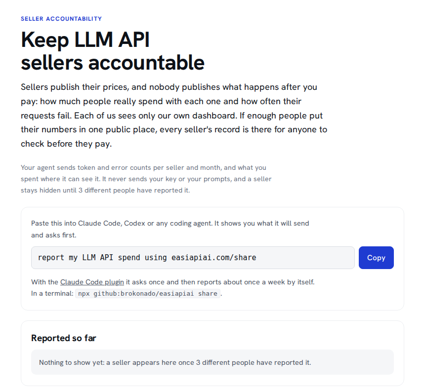
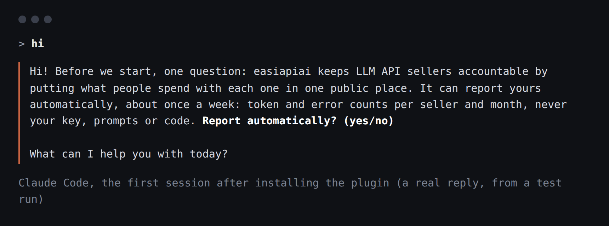
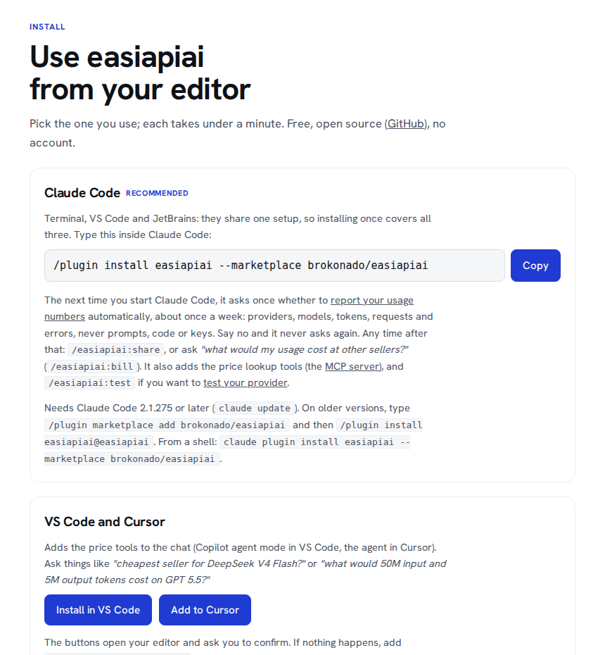

# easiapiai

**Keep LLM API sellers accountable**

Sellers publish their prices, and nobody publishes what happens after you pay: how much people really spend with
each one and how often their requests fail. Each of us sees only our own dashboard. If enough people put their
numbers in one public place, every seller's record is there for anyone to check before they pay.

It also prices your own usage at every seller of the same model, from [easiapiai.com](https://easiapiai.com)'s
price list (90+ sellers, updated every 6 hours).



## Install

**Claude Code** (terminal, VS Code, JetBrains). Type this inside Claude Code:

```
/plugin install easiapiai --marketplace brokonado/easiapiai
```

Next time you start Claude Code it asks once whether to report your numbers. Say yes and it reports about
once a week in the background; say no and it never asks again.



**Any terminal** (Node 18+):

```
npx github:brokonado/easiapiai share
```

**VS Code, Cursor, Claude desktop:** one-click buttons on [easiapiai.com/install](https://easiapiai.com/install).



## What you can ask

| Type in Claude Code | What happens |
|---|---|
| `/easiapiai:share` | reports your token and error counts per seller (shows them to you first) |
| `/easiapiai:bill` | prices your Claude Code / Codex usage at every seller of the same model |
| "cheapest seller for DeepSeek V4 Flash?" | looks it up in easiapiai's price list |

## What is sent, and what never is

| Sent | Never sent |
|---|---|
| provider and model | your API keys |
| month | prompts and replies |
| token counts (input, output, cached) | code, file names, project names |
| number of requests and errors | anything else |

Nothing appears on easiapiai.com until 3 different people have shared the same provider, and totals are rounded, so
no one's own numbers can be read off the site. Turn automatic reporting off any time:
`npx github:brokonado/easiapiai sharing off` (or ask Claude Code to turn it off).

## Where the numbers come from

Everything is read on your computer:

- the logs that **Claude Code**, **Codex**, **opencode**, **Kilo Code** and **Cline** already keep (token counts,
  errors, and which provider and model);
- **OpenRouter**'s usage report, if you set `OPENROUTER_MANAGEMENT_KEY` (it says which provider served each model);
- anything you type in at [easiapiai.com/share](https://easiapiai.com/share).

The exact counting rules are in [docs/DETAILS.md](docs/DETAILS.md).

## Also in here

- `easiapiai bill`: what your usage costs at every seller ([easiapiai.com/bill](https://easiapiai.com/bill));
- `easiapiai test`: an optional 10-question check of a provider, with your own key, on your own computer
  ([easiapiai.com/test](https://easiapiai.com/test)).

Free and open source (MIT), no dependencies. Sharing needs Node 18+; `bill` and `test` also run on Python 3.9+
(`uvx --from git+https://github.com/brokonado/easiapiai easiapiai bill`).
[Contributing](CONTRIBUTING.md) · [Privacy](https://easiapiai.com/privacy.html) · [easiapiai.com](https://easiapiai.com)
